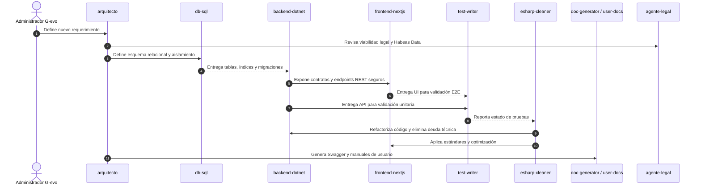

# Registro de Decisiones de Arquitectura y Asignación Rigurosa de Agentes (Sin Solapamientos)

> **Ecosistema:** G-evo Digital Hub  
> **Propósito:** Garantizar la estabilidad del proyecto, la integridad de los datos multi-tenant y evitar errores de asignación o solapamiento entre áreas técnicas.

---

## 1. Matriz de Responsabilidades y Límites Estrictos

Para garantizar que ningún agente interfiera en el dominio técnico de otro, las responsabilidades y restricciones quedan formalmente fijadas:

| Rol / Agente | Responsabilidades Específicas | Limitaciones Estrictas (Qué NO debe hacer para evitar errores) |
| :--- | :--- | :--- |
| **`arquitecto`** | Diseñar la estructura general, flujos de datos multi-tenant y la comunicación global del sistema. | **NO** escribe código de producción ni configura servidores directamente. |
| **`frontend-nextjs`** | Desarrollar la interfaz visual de la web principal, el mostrario, el panel de admin y el panel de clientes en Next.js siguiendo la guía visual exacta. | **NO** manipula la lógica de bases de datos ni diseña esquemas SQL. |
| **`backend-dotnet`** | Construir la API central en .NET, la lógica de autenticación (login), los permisos por roles y la gestión de endpoints. | **NO** interviene en el diseño visual ni en las hojas de estilo del frontend. |
| **`db-sql`** | Diseñar, optimizar y asegurar el esquema de la base de datos relacional garantizando el aislamiento de datos por cliente. | **NO** escribe lógica de negocio ni controladores de API. |
| **`test-writer`** | Escribir y ejecutar pruebas unitarias (backend) y pruebas de extremo a extremo (E2E para flujos de login y catálogos). | **NO** modifica código fuente de producción directamente; solo reporta y valida fallos. |
| **`esharp-cleaner`** | Revisar la calidad estática del código, refactorizar malas prácticas y aplicar estándares limpios en .NET y Frontend. | **NO** añade nuevas funcionalidades de negocio, solo optimiza lo existente. |
| **`doc-generator`** | Mantener documentados los endpoints de la API y las guías técnicas del código. | **NO** documenta manuales comerciales para usuarios finales. |
| **`infra-terraform`** | Automatizar el despliegue de infraestructura en la nube (IaC), contenedores Docker y certificados SSL. | **NO** modifica el código de la aplicación ni interviene en la interfaz de usuario. |
| **`user-docs`** | Redactar exclusivamente los manuales paso a paso para los clientes finales sobre cómo usar su panel de administración. | **NO** redacta documentación interna de arquitectura técnica. |
| **`agente-legal`** | Velar por el cumplimiento normativo en protección de datos (Habeas Data/GDPR), pasarelas de pago y términos legales de los e-commerce. | **NO** toma decisiones de diseño técnico ni de infraestructura de servidores. |

---

## 2. Registro de Decisiones de Arquitectura (ADR)

### ADR-001: Aislamiento Estricto de Datos Multi-Tenant
* **Decisión:** Implementar aislamiento por columna `tenant_id` respaldado por Global Query Filters en Entity Framework Core y middleware de resolución en ASP.NET Core (`TenantResolutionMiddleware`).
* **Motivo:** Evitar que un cliente de catálogo pueda consultar, modificar o filtrar información de otro cliente, garantizando confidencialidad absoluta sin el costo de aprovisionar una base de datos física independiente por cada cliente pequeño.
* **Límite:** La responsabilidad de los índices y constraints es de `db-sql`; la inyección y validación del token JWT pertenece a `backend-dotnet`.

### ADR-002: Creación Centralizada vs. Autonomía de Gestión
* **Decisión:** La creación de tiendas, vinculación de dominios y emisión de tarjetas inteligentes queda restringida **únicamente al Administrador Maestro** de G-evo desde el panel maestro (`/admin`).
* **Motivo:** Asegura el control de calidad, preserva el modelo de negocio B2B y previene el spam o creación de tiendas no autorizadas.
* **Límite:** El cliente final sólo gestiona autónomamente su inventario (productos, precios, fotos, descripciones) una vez que el SuperAdmin le entrega credenciales de acceso.

### ADR-003: Monetización del Agente de Soporte IA mediante Códigos Criptográficos
* **Decisión:** El Agente de Soporte IA 24/7 opera en modo demostración gratuita al inicio. Su activación permanente se desbloquea mediante un código criptográfico único e intransferible emitido por el Administrador Maestro tras verificar el pago del cliente.
* **Estructura del Código:** `GEVO-{SLUG}-{MOD}-{CHECKSUM}` con hash seguro SHA-256 (`LicenseService`).
* **Límite:** La emisión pertenece al SuperAdmin; la activación pertenece al cliente en su panel; la validación pertenece a `backend-dotnet`.

### ADR-004: Frontend Desacoplado en Next.js con Tailwind CSS
* **Decisión:** Utilizar Next.js con App Router y Tailwind CSS para lograr velocidad de carga ultra-rápida (Mobile-First), animaciones fluidas, renderizado optimizado y modularidad total en componentes.
* **Límite:** `frontend-nextjs` solo consume endpoints REST/JSON definidos y no escribe queries directas a la base de datos.

---

## 3. Protocolo de Trabajo y Flujo entre Agentes

---

## 4. Estado de Implementación en el Repositorio

- **Esquema de Base de Datos y Semillas:** [`database/01_init_schema.sql`](file:///c:/Users/carlo/G-evo/database/01_init_schema.sql) y [`database/02_seed_data.sql`](file:///c:/Users/carlo/G-evo/database/02_seed_data.sql)
- **API Backend Multi-Tenant:** [`backend/src/Gevo.Api/`](file:///c:/Users/carlo/G-evo/backend/src/Gevo.Api/)
- **Frontend y Paneles de Control:** [`frontend/src/app/`](file:///c:/Users/carlo/G-evo/frontend/src/app/)
- **Documentación de APIs:** [`docs/API_SPECIFICATION.md`](file:///c:/Users/carlo/G-evo/docs/API_SPECIFICATION.md)
- **Manual de Usuario:** [`docs/MANUAL_USUARIO_PORTAL_CLIENTES.md`](file:///c:/Users/carlo/G-evo/docs/MANUAL_USUARIO_PORTAL_CLIENTES.md)
- **Infraestructura Docker:** [`infra/docker-compose.yml`](file:///c:/Users/carlo/G-evo/infra/docker-compose.yml)

